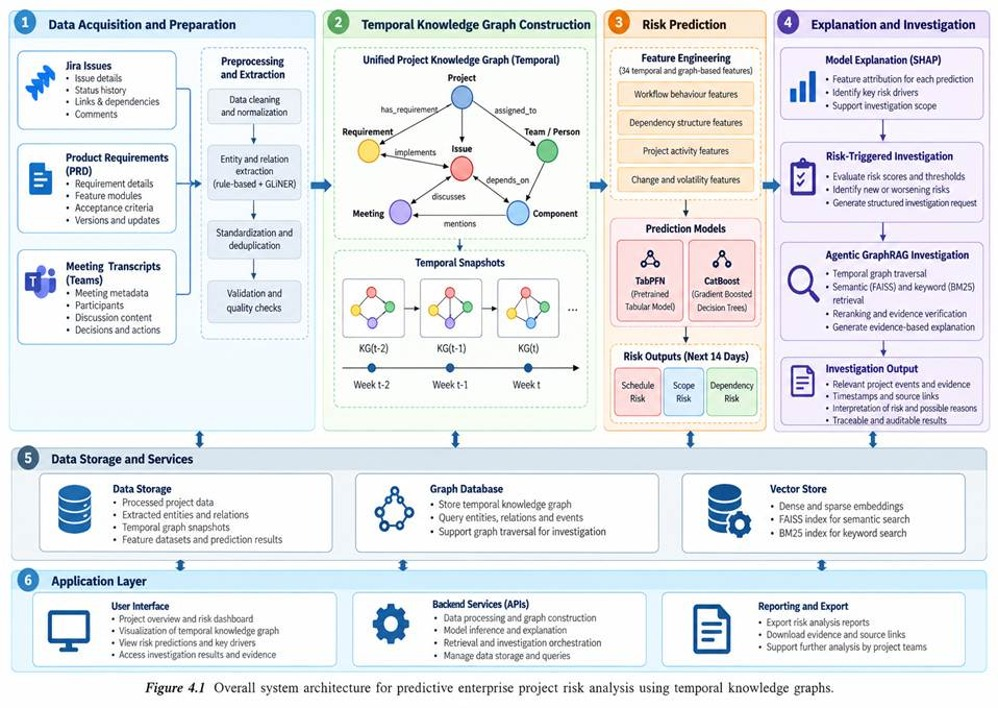

# [ Practice Module ] Project Submission

## SECTION 1 : PROJECT TITLE

# Predictive Enterprise Project Risk Analysis Using Temporal Knowledge Graphs

## SECTION 2 : EXECUTIVE SUMMARY / PAPER ABSTRACT

Software projects produce issue histories, requirements, meeting records and dependency data that change over time. This project brings those sources together to investigate how temporal knowledge graphs, machine learning and evidence-grounded language models can support project-risk analysis.

The workflow starts with public Jira data. Selected project instances are enriched with **synthetically generated** project requirements documents (PRDs) and meeting transcripts; those generated materials are not independently collected enterprise records. The notebooks extract entities, relationships and events with source and time provenance, resolve entity mentions, and construct a temporal knowledge graph.

Historical project checkpoints are then used to create point-in-time features and 14-day Schedule, Scope and Dependency Risk labels. TabPFN and CatBoost models produce risk scores and investigation triggers. An event-focused GraphRAG retrieval stage assembles checkpoint-eligible Jira and graph evidence. The final demonstration notebook browses saved investigation reports and can run a separate, single-case Qwen evidence-summary demonstration.

This is a research prototype assembled from notebooks, not a one-command production application. Each stage depends on external data and artifacts created by earlier stages. Results should be interpreted with the evaluation scope and limitations described below.

## SECTION 3 : PROJECT OBJECTIVES

- Prepare selected public Jira project histories and temporally aligned synthetic PRDs and meeting transcripts.
- Extract project entities, relationships, events and temporal information with source provenance.
- Resolve entity mentions and construct a temporal knowledge graph.
- Reconstruct historical checkpoints and engineer features using only information available at each checkpoint.
- Investigate prediction of Schedule, Scope and Dependency Risk over a 14-day horizon.
- Retrieve historical graph/Jira evidence for selected risk investigations and present it with citations.
- Evaluate data, extraction, graph, prediction, retrieval and explanation components while documenting their limits.

## SECTION 4 : SYSTEM ARCHITECTURE



The repository contains separately developed notebooks for each stage. It does not provide a single automated orchestration command; follow the prerequisites and execution order documented in the component READMEs.

## SECTION 5 : REPOSITORY STRUCTURE

```text
.
├── Miscellaneous/
├── ProjectReport/
├── SystemCode/
│   ├── DataGeneration/
│   ├── KnowledgePipeline/
│   │   └── evaluation/
│   │       └── experiments/
│   ├── MachineLearning/
│   │   └── evaluation/
│   └── AgenticRAG/
│       ├── data/
│       └── evaluation/
└── Video/
```

- [SystemCode/README.md](./SystemCode/README.md) describes the end-to-end notebook sequence.
- [DataGeneration/README.md](./SystemCode/DataGeneration/README.md) covers dataset preparation and synthetic artifacts.
- [KnowledgePipeline/README.md](./SystemCode/KnowledgePipeline/README.md) covers extraction, entity resolution and temporal graph construction.
- [MachineLearning/README.md](./SystemCode/MachineLearning/README.md) covers snapshots, features, risk models and triggers.
- [AgenticRAG/README.md](./SystemCode/AgenticRAG/README.md) documents evidence retrieval and the final demo notebook.

## SECTION 6 : DATASET

The primary source is public historical Jira data organized into project instances and weekly checkpoints. For selected instances, PRDs and meeting transcripts are generated synthetically from temporally available project information. They must be identified as generated artifacts and must not be described as independently collected company documents.

The documented snapshot/modeling workflow uses 30 project instances and 987 weekly checkpoints, with a 14-day outcome horizon. Raw source datasets, generated artifacts, full graph exports and many intermediate files are external to this Git repository and must be placed in the paths expected by the relevant notebooks. See each component README before attempting upstream reproduction.

Source IDs, timestamps, checkpoint boundaries and provenance are essential to interpreting results. Future information is used to define supervised outcomes, not as a predictive feature or as evidence available to a historical investigation.

## SECTION 7 : TECHNOLOGIES

The implementation is primarily Python notebooks developed for Google Colab and Google Drive. The notebooks use data-science libraries such as pandas, NumPy, PyArrow and scikit-learn; GLiNER for semantic extraction; Neo4j-related graph tooling; TabPFN and CatBoost for risk prediction; SHAP for model attribution; and BM25, FAISS, sentence-transformers, cross-encoders and Qwen for retrieval and report demonstrations. Exact dependencies and runtime requirements vary by notebook; there is no repository-wide pinned environment.

## SECTION 8 : CREDITS / PROJECT CONTRIBUTION

| Official Full Name | Student ID | Work Items | Email (Optional) |
|---|---|---|---|
| Akansha Sajimon | A0352134N | Entity resolution; Neo4j graph population; PRD and meeting generation | akanshasajimon@u.nus.edu |
| Cho Laqshya | A0357002R | Agentic notebooks and demo; all evaluation notebooks | cho.laqshya@u.nus.edu |
| Rajamanickam Abirami | A0354513J | Entity extraction; dataset download; project selection | abiramirajamanickam@u.nus.edu |
| Ravikumar Prithika | A0354287U | Machine learning; event-focused retrieval | prithika.ravikumar@u.nus.edu |

## SECTION 9 : VIDEO OF SYSTEM MODELLING & USE CASE DEMO

Presentation and demonstration media are present in [Video/](./Video/).
## SECTION 10 : USER GUIDE

### Final runnable demonstration

The final demonstration notebook is [GC1_Professor_Demo_Live_and_139_Report_Browser.ipynb](./SystemCode/AgenticRAG/GC1_Professor_Demo_Live_and_139_Report_Browser.ipynb). It contains a browser for the previously generated 139 V5 reports and a separate single-case Qwen evidence-summary flow. The browser and live Qwen summary are different features; running the live summary does not recreate the original 139-report batch.

The full-run report file `SystemCode/AgenticRAG/data/llm_pilot_reports.jsonl` is included with the demo inputs. The notebook validates that it contains exactly 139 reports with unique trigger IDs before opening the report browser.

#### Run in Google Colab

1. Open the notebook in Colab and use a runtime with a **T4 GPU** (or compatible CUDA GPU) for the Qwen section. The saved-report browser itself does not need a GPU.
2. Make the cloned repository's `SystemCode/AgenticRAG` directory the notebook working directory, or edit `REPO_ROOT` in the environment-configuration cell to point to that directory. The notebook uses the current working directory to locate `data/` and create `demo_outputs/`.
3. Keep `llm_pilot_reports.jsonl`, `test_predictions.parquet` and `agentic_graphrag_retrieval_queue.jsonl` in the notebook's `data/` directory.
4. Run cells from top to bottom. Allow the lightweight dependencies (`pandas`, `pyarrow`, `ipywidgets`) to install. Confirm the setup cell reports valid paths and that the report-browser checks accept 139 unique reports.
5. Use the browser controls to inspect reports and export the report summary. Outputs are written under `SystemCode/AgenticRAG/demo_outputs/`.
6. To run the separate live summary, select a supported test case and continue through the Qwen setup and generation cells. The notebook installs Transformers/Accelerate/bitsandbytes, downloads `Qwen/Qwen2.5-3B-Instruct`, and requires CUDA. Do not treat generated text as causal proof or as a replacement for the saved reports.
7. Review the evidence IDs, checkpoint timestamps and generated output before presenting it. The notebook's own checks do not establish factual accuracy.

In a local VS Code/Jupyter environment, use a compatible Python kernel and install the notebook's listed dependencies first. The Qwen inference cells are not expected to work on a CPU-only machine.

#### Reproduce the upstream pipeline

For dataset preparation, extraction/graph construction, risk prediction and retrieval, follow the notebook order and external-data requirements in the component READMEs. In brief: Data Generation → Knowledge Pipeline → Machine Learning → AgenticRAG retrieval → final demo. The final demo can browse supplied saved reports without rerunning all upstream experiments, but it cannot run without the report JSONL.

## SECTION 11 : PROJECT REPORT / PAPER

The project report belongs in [ProjectReport/](./ProjectReport/). Recommended coverage includes the problem and related work, dataset and synthetic-data methodology, system architecture, temporal extraction and graph construction, point-in-time feature design, model and retrieval methodology, evaluation, results, limitations, references and appendices. Clearly distinguish implemented results from proposed work and disclose data/runtime dependencies.

## SECTION 12 : EVALUATION

Evaluation is component-specific:

- **Data generation:** temporal alignment, provenance and source grounding.
- **Extraction and graph:** structural validation, temporal consistency, source identity and entity-resolution review.
- **Machine learning:** project-level splits, label validation, leakage audits, validation-based threshold selection and risk-specific metrics.
- **Retrieval and reports:** checkpoint eligibility, retrieval ranking, evidence use and claim support.

Evaluation notebooks and audit files are under the corresponding component `evaluation/` folders. Reported counts and preliminary/AI-assisted reviews are not equivalent to independently verified accuracy. In particular, a valid evidence citation does not by itself prove that a claim is true, and the current saved-output audits do not establish causal effects. Consult each evaluation README for its scope, inputs and caveats.
